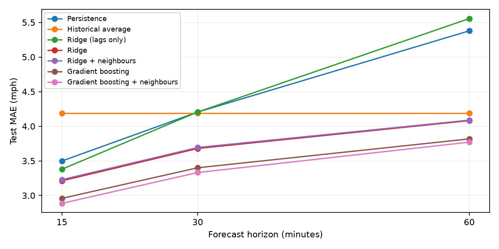
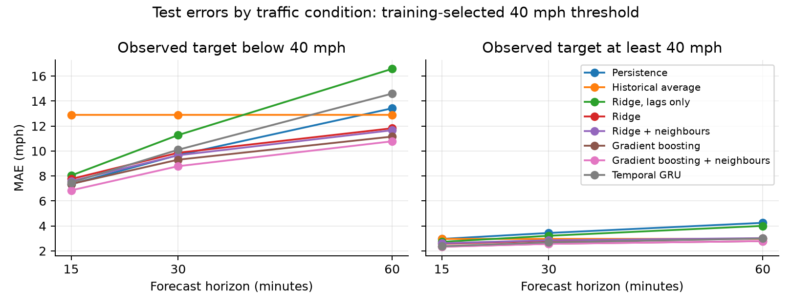
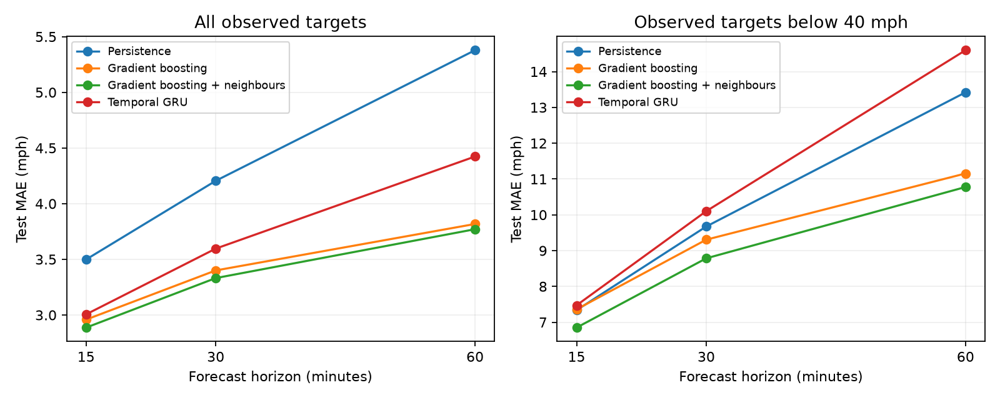
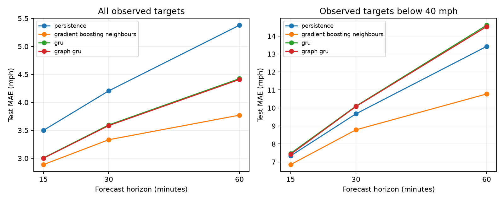

# Spatiotemporal traffic speed forecasting

Group 30, ELEC3544. This repository forecasts METR-LA traffic speeds 15, 30 and 60 minutes ahead. It contains the data pipeline, exploratory analysis, baselines and classical models, including validation tuning and spatial feature ablations. A shared per-sensor GRU provides the temporal neural baseline. A GRU with learned graph filtering tests the spatial contribution against a separately trained disabled-graph control. See [remaining work](docs/tasks.md).

## Run

Requires [uv](https://docs.astral.sh/uv/). The first run downloads the dataset (13 MB) to `data/raw/` and checks its SHA-256.

```sh
uv sync
uv run pytest            # data alignment, split and metric checks
uv run scripts/eda.py    # figures and summary in outputs/eda/
uv run scripts/evaluate.py   # metrics in outputs/results/metrics.csv
```

`evaluate.py` takes model names to rerun only some models, for example `uv run scripts/evaluate.py ridge`. Tuning and ablation repeat model training and can take substantially longer than a single evaluation.

## Layout

- `src/traffic/data.py` loads the data, builds the sensor graph, and defines splits and windows.
- `src/traffic/metrics.py` holds MAE, RMSE and MAPE with missing targets masked out.
- `src/traffic/models.py` holds the baselines and the ridge and gradient-boosting models.
- `scripts/` holds the runnable analysis. `outputs/predictions/` (not committed) holds test predictions for error analysis.

## Data decisions

These use DCRNN (Li et al., 2018) benchmark conventions. Adjacent split target periods share eleven timestamps (55 minutes); results do not represent fully disjoint target periods.

- **Source.** `metr_la.h5`: 34,272 five-minute steps from 1 March to 27 June 2012, 207 sensors. It comes from the Torch Spatiotemporal mirror of the DCRNN files.
- **Windows.** Each window has 12 input steps (1 hour) and 12 target steps. We report steps 3, 6 and 12, which are 15, 30 and 60 minutes.
- **Splits.** Windows are split 70/10/20 in time order: 23,974 train, 3,425 validation and 6,850 test windows. These match DCRNN exactly.
- **Missing values.** A speed of 0 means the sensor did not report. This covers 8.1% of readings overall and 12.1% in the test period.
  - Targets: zeros are excluded from training and from every metric.
  - Inputs: we carry the last observed value forward. This uses only past data. A gap at the very start of the series takes the sensor's training mean instead.
- **Graph.** The weight between two sensors is `exp(-(d/σ)^2)`, where `d` is road distance and `σ` is the standard deviation of all distances. Weights below 0.1 are set to 0. The resulting graph is directed and has 1,515 edges besides self-loops.
- **Normalisation.** `MetrLA.normalizer()` returns the mean and standard deviation of observed training speeds, for z-scoring inputs to the neural models. Ridge standardises its features; boosting uses the feature values directly.
- **Leakage.** The weekly profile, fill values and normaliser use only the training period. `tests/test_data.py` checks this for the profile.

## Models so far

| Model | Inputs |
|---|---|
| Graph GRU | incoming and outgoing road-weighted speed/observation signals, followed by the shared GRU |
| Temporal GRU | own sensor history, observation flags, and calendar inputs; shared weights |
| Persistence | last observed speed |
| Historical average | mean training speed for that sensor and 5-minute slot of the week |
| Ridge, lags only | 12 lagged speeds, share of the window that was missing |
| Ridge | lags, calendar (time of day, day of week, weekend) at the target time, weekly-profile speed |
| Ridge / gradient boosting + neighbours | corresponding model inputs plus neighbour speeds, changes and weighted mean |
| Gradient boosting | ridge inputs plus sensor ID as a category; 1M sampled training rows; early stopping on validation |

The ridge and gradient-boosting models train one model per horizon, pooled across all sensors.

## Integrated classical-model work

Integrated from Saif's [`task2-models` commit ce18f4c](https://github.com/saifho/elec3544-traffic-forecast/commit/ce18f4c1d603e3a2b413ce7233eb59aefbfa7baf). The upstream `main` only contains the original baseline.

Training profile features exclude the target's whole calendar week from both origin and target estimates and their fallback means, including forecasts that cross week boundaries. Validation and test features use the full training profile. Neighbour features use the three strongest links after symmetrising the directed graph by maximum weight, their latest speeds and 15-minute changes, and a weighted average over all neighbours. Missing neighbours fall back to the sensor itself.

```sh
uv run scripts/evaluate.py --tune      # tuning.csv and best_params.json
uv run scripts/evaluate.py            # seven models, metrics and predictions
uv run scripts/evaluate.py --ablation # ablation.csv
uv run scripts/error_analysis.py      # all recorded models by traffic condition
uv run scripts/summarize_results.py   # baseline checks, report and figures
```

Tuning chooses ridge alpha separately for each feature set. Boosting settings are selected with the profile feature set and reused for the other ablations. All choices use validation MAE. The follow-up runs tune on validation and regenerate evaluation, ablations, and traffic-condition results. Original metrics are retained in `outputs/results/previous_metrics.csv`.

## Exploratory analysis

The training-only comparison retains 40 mph as a common low-speed definition. It flags 10.50% of observed training readings, compared with 9.16% for the sensor-relative rule. Both are descriptive definitions. Whole-network outages account for about 86% of the increase in test missingness. Most selected neighbour pairs have their strongest residual correlation at zero lag; the analysis does not establish directional traffic propagation.

See [EDA methods, findings and figures](docs/eda.md), [classical-model methods and results](docs/classical_models.md), and [experiment provenance](docs/experiment_notes.md).

## Classical test results

MAE in mph, after calendar-week profile exclusion and validation selection:

| Model | 15 min | 30 min | 60 min |
|---|---|---|---|
| gradient_boosting | 2.958 | 3.4 | 3.818 |
| gradient_boosting_neighbours | 2.887 | 3.332 | 3.771 |
| historical_average | 4.186 | 4.186 | 4.186 |
| persistence | 3.498 | 4.205 | 5.378 |
| ridge | 3.212 | 3.679 | 4.081 |
| ridge_lags | 3.38 | 4.206 | 5.556 |
| ridge_neighbours | 3.228 | 3.693 | 4.088 |

Full MAE, RMSE, MAPE, tuning trials, and ablations are saved in `outputs/results/`. The report explains the shared boosting settings and split-boundary limitation.



## Errors by traffic condition

Run `uv run scripts/error_analysis.py` after evaluation. It checks prediction alignment, shape, finiteness, and every recorded model/horizon aggregate against `metrics.csv` before grouping by observed target speed. This is retrospective error analysis, not congestion detection. Missing targets are excluded, and overlapping windows produce dependent forecast-target pairs.



## Temporal neural baseline

Install the optional neural dependencies to train or restore the shared per-sensor GRU:

```sh
uv sync --extra neural
uv run --extra neural scripts/train_gru.py --device cpu
uv run --extra neural scripts/train_gru.py --device cpu --evaluate-only
uv run scripts/error_analysis.py
uv run scripts/summarize_neural.py
```

Training compares two learning rates using the same initialized weights and one million sampled window/sensor rows. Validation selects the checkpoint and learning rate; test evaluation follows selection. The checkpoint, settings, validation histories, and learning curves are in `outputs/neural/`. The evaluate-only command restores the saved weights and checks the data hash and sensor order. Run `uv run --extra neural pytest` to include the neural tests; they skip when PyTorch is absent.

See the [temporal-model report](docs/temporal_model.md) for methods, measured results, and limits. Classical and GRU inputs differ, so the comparison is between implemented systems. The [graph-model report](docs/graph_model.md) compares temporal and graph variants under matched settings.



## Graph comparison

```sh
uv run --extra neural scripts/train_gru.py --model graph_gru --device cpu
uv run --extra neural scripts/train_gru.py --model graph_gru_no_graph --device cpu
uv run --extra neural scripts/train_gru.py --model graph_gru --device cpu --evaluate-only
uv run --extra neural scripts/train_gru.py --model graph_gru_no_graph --device cpu --evaluate-only
uv run scripts/error_analysis.py
uv run scripts/summarize_graph.py
```

The graph filter keeps incoming and outgoing road links separate, removes self-loops from neighbour aggregation, and row-normalizes weights. Isolated rows fall back to local values. Both variants use the same temporal architecture, initial GRU/head parameters, training sample, seed, two learning rates, and validation budget. The disabled graph is trained separately with identity supports. Each checkpoint checks the data and adjacency hashes on restoration.

See [graph methods, ablation and results](docs/graph_model.md). The core model comparison is implemented; the detailed error analysis is complete, and final report/presentation assembly remains.



## Detailed error analysis

```sh
uv run scripts/error_analysis.py
uv run scripts/detailed_error_analysis.py
```

The [error-analysis report](docs/error_analysis.md) covers all ten models by sensor, target hour, weekday/weekend, input availability, and speed change. Every subgroup partition is checked against pooled metrics. Representative sensors use training-only congestion ranks; failure examples are explicitly selected from test errors for illustration. CSV tables, trace values, selection rules, and figures are in `outputs/error_analysis/detailed/`. Counts are observed forecast-target pairs, with missing targets excluded.
