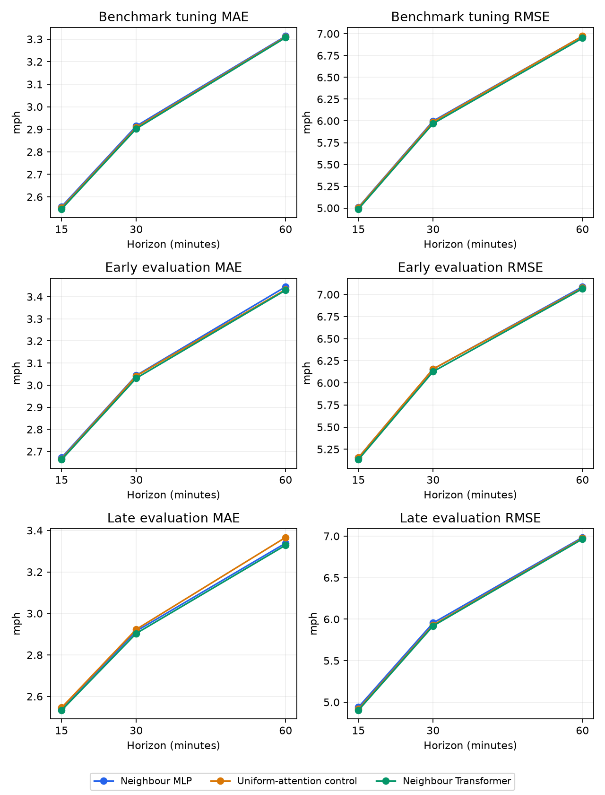

# Neighbour attention and purged rolling evaluation

A compact Transformer is compared with a matched uniform-attention intervention and the stronger neighbour MLP. This tests learned weighting of individual sensor histories. It is not a temporal Transformer over twelve time tokens or a reproduction of a published traffic model. Settings are fixed in `outputs/experiments/attention/protocol.json` before fitting.

## Architecture and controlled question

The encoder uses the residual multihead attention and feedforward pattern introduced in [Attention Is All You Need](https://arxiv.org/abs/1706.03762). Restricting attention to road-neighbour tokens draws on the idea of graph-restricted attention in [Graph Attention Networks](https://arxiv.org/abs/1710.10903); this implementation uses dot-product attention rather than the original GAT mechanism. No published result is reproduced or used as a directly comparable score.

Each prediction row has four tokens: the local sensor plus up to three neighbours chosen by the largest weight in either road direction, with stable ordering and zero self-weights. Each token contains twelve normalized speeds and flags, log consecutive missing age at the origin, the shared 16-dimensional sensor embedding, incoming/outgoing road weights and a self indicator. Invalid road-neighbour slots are masked; the local token is always valid. Measurement gaps are represented by forward-filled speeds, flags and gap age. Token histories preserve temporal order by flattening the twelve readings. All sensor inputs end at the forecast origin.

A linear projection produces 16 channels. One pre-normalized Transformer encoder block has two attention heads, a 32-channel feedforward layer, residual connections and dropout 0.1 outside attention. Scaled dot-product attention uses zero dropout in both variants. The local output adds 16 hidden channels to the existing local and pooled-neighbour history representation. Two 144-channel residual prediction blocks retain the sensor/target-calendar/horizon features and local persistence anchor. The zero-initialized head reproduces persistence before training. Both attention variants have 97,001 parameters; the neighbour MLP has 76,569.

The control zeros queries and keys before attention, producing uniform weights over valid tokens. Every other parameter, input, initialized value, optimizer policy and sample plan matches. Query/key gradients are zero in the control. A gain over this control supports learned weighting within this architecture; it does not isolate time-varying attention from identity-based static preferences. Differences against the smaller MLP also bundle richer individual-neighbour inputs and extra capacity. Attention weights are not treated as causal explanations.

## Training and benchmark comparison

All trials use seed 42, masked MAE divided by training standard deviation, AdamW (learning rate 0.001, weight decay 0.0001), gradient clipping at 1, fresh one-million-row samples each epoch, batch size 2048 and a 50-epoch cap. ReduceLROnPlateau uses factor 0.5, patience three and threshold 0.0001; early stopping uses patience eight. Checkpoints minimize mean tuning MAE over 15, 30 and 60 minutes. Uniform and learned attention start identically. Sampling hashes match for all common epochs within each period. Training logic is shared with the earlier neural follow-up.

The benchmark MLP reuses the earlier unchanged seed-42 spatial MAE checkpoint. Its validation predictions must reproduce the earlier saved array exactly. Attention candidates retain the same benchmark data and budget. This benchmark retains the previously disclosed eleven overlapping target timestamps and reused validation period.

| Model | Mean MAE | Mean RMSE | Mean low-speed MAE |
| --- | --- | --- | --- |
| Neighbour MLP | 2.9281 | 5.993 | 8.7115 |
| Uniform-attention control | 2.9234 | 5.9882 | 8.5327 |
| Neighbour Transformer | 2.9186 | 5.9695 | 8.5737 |

On benchmark mean validation MAE, the Transformer has a +0.17% gain relative to uniform attention and +0.33% relative to the MLP. Positive means lower error; negative means higher error. RMSE and low-speed MAE are secondary measurements, not alternate selection criteria.

A fixed input-only sample of 10,000 tuning rows per period records normalized local-query attention entropy and self-weight statistics in `attention_diagnostics.csv`. Entropy one means uniform attention over valid tokens; zero means concentration on one token. Statistics exclude sensors with no valid neighbour and average both heads. Different weights alone do not establish forecasting value or causal importance; the matched forecast comparison is the evidence for utility. This diagnostic does not select models or change settings.

## Purged period design

The earlier evaluation starts fourteen days before the benchmark validation target start. The later evaluation starts at that benchmark validation target start. Each has a preceding seven-day tuning period and an expanding training prefix. Every twelve-step target sequence must remain wholly inside its assigned period. Histories may use earlier observed speeds, as in rolling forecasting. Full target ranges do not overlap across training, tuning or evaluation. Initial-gap filling and normalization are refitted to that fold's training prefix. Every model is trained from scratch for each rolling period.

All three checkpoints for a period must be selected using only tuning data before any evaluation score is exposed. Evaluation windows have seven calendar days of targets and remain before the original benchmark test targets. The architecture, loss, seed and training settings are held fixed regardless of the benchmark result. The two periods evaluate temporal sensitivity, not the isolated effect of purging: the training spans and checkpoint-selection periods also differ from the original benchmark.

| period | split | first_target | last_target | windows |
| --- | --- | --- | --- | --- |
| benchmark | train | 2012-03-01 01:00:00 | 2012-05-23 07:40:00 | 23974 |
| benchmark | val | 2012-05-23 06:50:00 | 2012-06-04 05:05:00 | 3425 |
| early | train | 2012-03-01 01:00:00 | 2012-05-02 06:45:00 | 17915 |
| early | val | 2012-05-02 06:50:00 | 2012-05-09 06:45:00 | 2005 |
| early | evaluation | 2012-05-09 06:50:00 | 2012-05-16 06:45:00 | 2005 |
| late | train | 2012-03-01 01:00:00 | 2012-05-16 06:45:00 | 21947 |
| late | val | 2012-05-16 06:50:00 | 2012-05-23 06:45:00 | 2005 |
| late | evaluation | 2012-05-23 06:50:00 | 2012-05-30 06:45:00 | 2005 |

| Period | Model | Mean MAE | Mean RMSE | Mean low-speed MAE |
| --- | --- | --- | --- | --- |
| early | Neighbour Transformer | 3.0412 | 6.1082 | 8.7868 |
| early | Neighbour MLP | 3.0536 | 6.1328 | 8.8179 |
| early | Uniform-attention control | 3.0469 | 6.1289 | 8.762 |
| late | Neighbour Transformer | 2.9219 | 5.9284 | 8.7616 |
| late | Neighbour MLP | 2.9323 | 5.9591 | 8.8176 |
| late | Uniform-attention control | 2.9452 | 5.94 | 8.5514 |

| period | attention_gain_vs_uniform_pct | attention_gain_vs_mlp_pct |
| --- | --- | --- |
| early | 0.184 | 0.404 |
| late | 0.791 | 0.354 |

Positive gains favour the Transformer. Negative gains mean higher error. These are fixed-protocol comparisons; outer scores do not trigger setting changes or checkpoint reselection.



## Verification and limits

Input tests cover masking, missing neighbours, permutation of neighbour tokens, uniform query/key gradients, initialization, prediction alignment, checkpoint restoration, future-speed perturbations, disjoint target ranges and training-only preprocessing. Each trial restores its selected checkpoint before saving validation predictions. Repeated restoration requires exact equality with an existing prediction array. Evaluation restores and verifies all tuning predictions before scoring a period. Prediction metadata, checkpoint hashes and all 180 subgroup partitions are checked in this report. All 145 protected prior artifacts retain their hashes.

This is one seed per model and period. The dataset periods have already been used in earlier project work, so this is retrospective temporal sensitivity with correct fold-local fitting, not pristine unseen data. The later fold may train on the earlier fold's evaluation week, as permitted in expanding-window evaluation; folds are not independent replications. The protocol forbids outer-score tuning, but global architecture choices still reflect prior dataset exploration. Small width, one encoder block, three neighbours and the fixed budget limit claims about Transformers in general. 3 of 9 selected checkpoints occur at epoch 50; convergence is not established for those runs. Further seeds, longer history, a temporal Transformer, other neighbourhood sizes and a new dataset are separate experiments. No original benchmark test scores are added.

## Further experiments worth separating

- Test temporal attention with a longer history while giving its MLP control the same history. The current model attends across four sensor histories, so it does not test the value of attention across time tokens.
- A fuller traffic-specific reference is [STAEformer](https://arxiv.org/abs/2308.10425). Its [official implementation](https://github.com/XDZhelheim/STAEformer/blob/main/model/STAEformer.py) combines adaptive embeddings with separate temporal and spatial attention over joint network windows. That would require a different full-network batching design and a separate reproduction; this pilot is not evidence about its attainable performance.
- Supply the training weekly-profile features to both neural variants using the existing whole-week cross-fitting rule. Boosting already has this information. This tests feature parity before attributing the remaining gap solely to architecture.

## Reproduction

```sh
uv run --extra neural scripts/try_attention.py --prepare
uv run --extra neural scripts/try_attention.py --period benchmark --variant mlp
uv run --extra neural scripts/try_attention.py --period benchmark --variant uniform
uv run --extra neural scripts/try_attention.py --period benchmark --variant attention
uv run --extra neural scripts/summarize_attention.py --benchmark-only
# For each of early and late, fit each of mlp, uniform and attention first:
uv run --extra neural scripts/try_attention.py --period early --variant mlp
# After all three fits for that period:
uv run --extra neural scripts/try_attention.py --period early --evaluate-period
# Repeat for late, then:
uv run --extra neural scripts/summarize_attention.py
```

Trial histories, selected checkpoints and immutable contracts live in `outputs/experiments/attention/<period>/<variant>/`. Saved prediction arrays stay under ignored `outputs/predictions/`. Repeat a fitting command with `--evaluate-only` to check exact restoration without fitting again.
