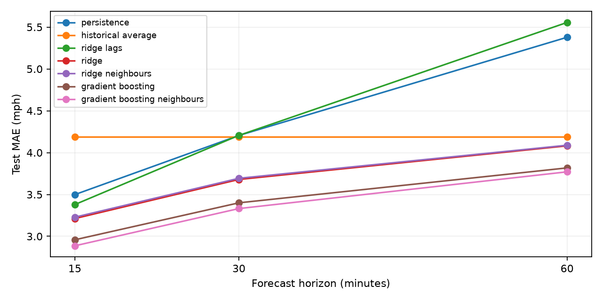
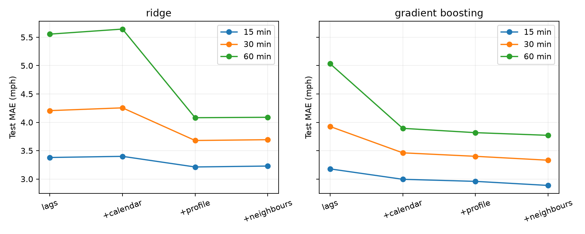

# Baselines and classical models

We compare persistence, historical average, ridge regression, and histogram gradient boosting on the existing METR-LA benchmark windows. Inputs cover one hour; reported horizons are 15, 30, and 60 minutes. Models share the same splits, observed-target masks, and scoring functions. MAE and RMSE are in mph; zero targets are excluded.

## Features and profile correction

The feature sequence adds calendar variables, weekly-profile speeds, and neighbour measurements to twelve lagged speeds and the input-window missing share. Calendar features encode target time of day and week with sine/cosine terms plus a weekend indicator. Profile features give the weekly mean at the origin and target slots. Each training row excludes the target's entire Monday-to-Sunday calendar week from both profile estimates and fallback means, including forecasts crossing a week boundary. Empty slots use the sensor mean outside that week, then the global observed mean outside that week. Validation and test use the full training profile.

Neighbour features use the three strongest connections after taking the maximum of both directed weights. They contain latest speeds, 15-minute changes, and a weighted average of all connected sensors. Absent neighbours fall back to the sensor's own measurements. Boosting also receives categorical sensor ID in every ablation; ridge is pooled across sensors without sensor ID. Therefore comparisons within each model isolate feature additions, while cross-model comparisons also reflect different feature representations.

## Validation selection

Ridge alpha is selected separately for each feature set from 0.1, 1, 10, 100, and 1000. Boosting searches max_leaf_nodes in 31, 63, 127; learning_rate in 0.05, 0.1; and min_samples_leaf in 100, 400. Selection minimizes mean validation MAE over the three horizons. Boosting settings are selected using lags, calendar, profile, and sensor ID, then held fixed across ablations. This measures feature additions under a shared boosting configuration, rather than each feature set's separately optimized performance.

Boosting samples at most one million observed training rows per horizon, with the horizon step as the sampling seed. Early stopping uses at most 200,000 chronological-validation rows sampled with seed 100 plus the horizon. The maximum iteration count is 500 and patience is 20; boosting random_state is 0. The same validation period supplies stopping and selection, so its error is a selection statistic. Test scores are used for reporting only.

Selected settings:

```json
{
  "ridge_alpha": {
    "lags": 0.1,
    "+calendar": 0.1,
    "+profile": 1000.0,
    "+neighbours": 1000.0
  },
  "gb_params": {
    "max_leaf_nodes": 127,
    "learning_rate": 0.05,
    "min_samples_leaf": 400
  }
}
```

## Test results

| model | MAE 15 min | MAE 30 min | MAE 60 min | RMSE 15 min | RMSE 30 min | RMSE 60 min |
| --- | --- | --- | --- | --- | --- | --- |
| gradient_boosting | 2.958 | 3.4 | 3.818 | 5.402 | 6.323 | 7.125 |
| gradient_boosting_neighbours | 2.887 | 3.332 | 3.771 | 5.164 | 6.111 | 6.986 |
| historical_average | 4.186 | 4.186 | 4.186 | 7.851 | 7.851 | 7.852 |
| persistence | 3.498 | 4.205 | 5.378 | 6.416 | 8.049 | 10.34 |
| ridge | 3.212 | 3.679 | 4.081 | 5.693 | 6.611 | 7.356 |
| ridge_lags | 3.38 | 4.206 | 5.556 | 6.102 | 7.597 | 9.524 |
| ridge_neighbours | 3.228 | 3.693 | 4.088 | 5.626 | 6.548 | 7.316 |



Persistence and historical-average results match the saved pre-integration scores on validation and test at all three horizons, for MAE, RMSE, MAPE, and counts, within CSV rounding precision. The check is recorded in `baseline_verification.json`.

## Feature ablations

| model | feature_set | MAE 15 min | MAE 30 min | MAE 60 min | RMSE 15 min | RMSE 30 min | RMSE 60 min |
| --- | --- | --- | --- | --- | --- | --- | --- |
| gradient_boosting | lags | 3.178 | 3.926 | 5.034 | 5.824 | 7.187 | 8.826 |
| gradient_boosting | +calendar | 2.995 | 3.462 | 3.894 | 5.439 | 6.369 | 7.165 |
| gradient_boosting | +profile | 2.958 | 3.4 | 3.818 | 5.402 | 6.323 | 7.125 |
| gradient_boosting | +neighbours | 2.887 | 3.332 | 3.771 | 5.164 | 6.111 | 6.986 |
| gradient_boosting | +profile (leaky) | 3.075 | 3.492 | 3.859 | 5.653 | 6.548 | 7.275 |
| ridge | lags | 3.38 | 4.206 | 5.556 | 6.102 | 7.597 | 9.524 |
| ridge | +calendar | 3.4 | 4.255 | 5.645 | 6.086 | 7.559 | 9.433 |
| ridge | +profile | 3.212 | 3.679 | 4.081 | 5.693 | 6.611 | 7.356 |
| ridge | +neighbours | 3.228 | 3.693 | 4.088 | 5.626 | 6.548 | 7.316 |
| ridge | +profile (leaky) | 3.357 | 3.761 | 4.078 | 5.804 | 6.69 | 7.389 |



For ridge, adding neighbours reduces test MAE by -0.016, -0.014, -0.007 mph at 15, 30, and 60 minutes respectively. Negative values mean the added features worsen error. Replacing the leaky profile with the corrected profile reduces MAE by 0.145, 0.082, -0.003 mph at the same horizons. These are measured differences for these settings, not significance tests.

For gradient boosting, adding neighbours reduces test MAE by 0.072, 0.069, 0.047 mph at 15, 30, and 60 minutes respectively. Negative values mean the added features worsen error. Replacing the leaky profile with the corrected profile reduces MAE by 0.117, 0.092, 0.041 mph at the same horizons. These are measured differences for these settings, not significance tests.

The leaky-profile runs use the corrected profile model's selected settings. They isolate the feature construction difference at those settings; they are not a rerun of the entire old selection procedure. Original metrics are retained separately in `previous_metrics.csv`.

## Evaluation limits

Adjacent benchmark split target periods overlap by eleven timestamps, or 55 minutes. We preserve this protocol for comparability and do not claim fully disjoint target periods. Training profiles may contain training-period observations later than a particular training row; cross-fitting removes that row's calendar week but is not a rolling-origin simulation. Neighbour features use only information available at the forecast origin.

Overlapping windows, shared sensors, and reciprocal graph links make errors dependent. No significance claim follows from small MAE differences alone. The comparison establishes classical reference results for the planned temporal and graph neural models. It does not yet answer whether graph neural modelling improves on a matched temporal architecture. Traffic-condition results are saved separately in `outputs/error_analysis/`.

Reproduce with `uv run scripts/evaluate.py --tune`, `uv run scripts/evaluate.py`, `uv run scripts/evaluate.py --ablation`, `uv run scripts/error_analysis.py`, and `uv run scripts/summarize_results.py`. Package versions and selected settings are recorded in `outputs/results/run_metadata.json`.
