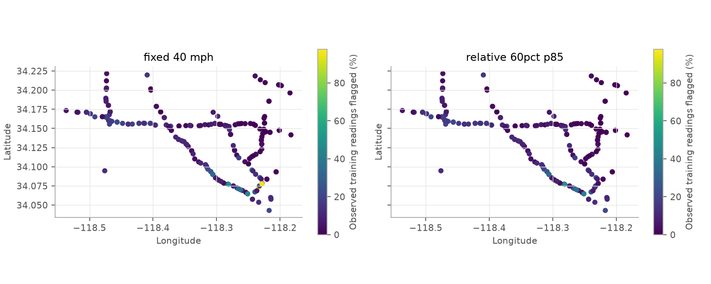
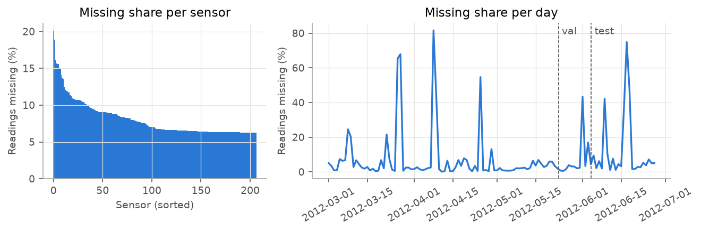
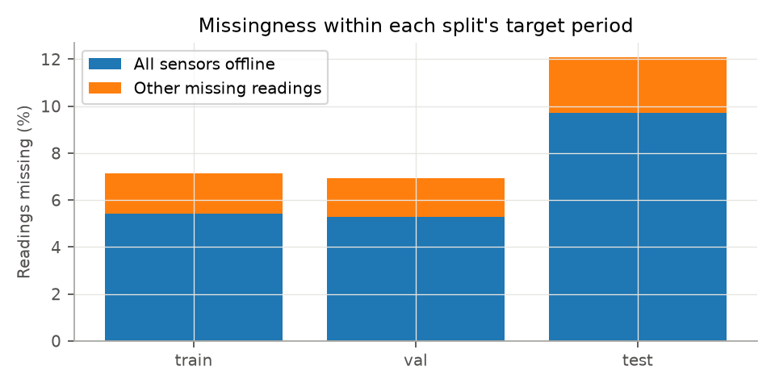
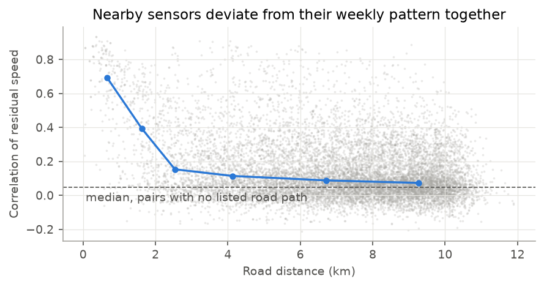
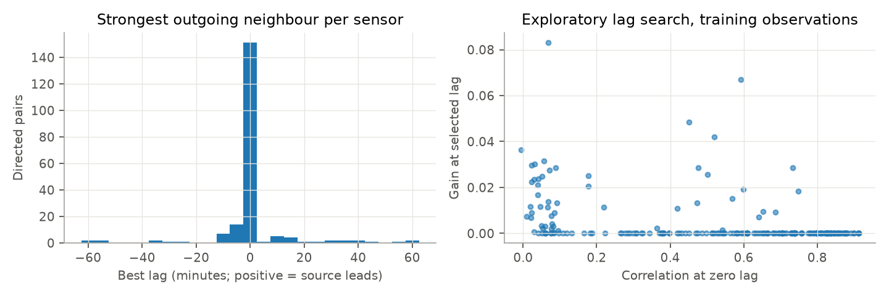

# Exploratory analysis

METR-LA contains 34,272 five-minute readings from 207 sensors between 1 March and 27 June 2012. Zero denotes a missing reading. Threshold comparisons and lag searches below use only the training period. Missingness is described over the full dataset and each split's target period; those target periods overlap by eleven timestamps at each boundary.

## Low-speed definition

The fixed rule, observed speed below 40 mph, flags 484,477 of 4,613,185 observed training readings (10.50%). The relative rule, speed below 60% of each sensor's training 85th-percentile speed, flags 422,643 readings (9.16%). Both rules flag at least one reading at all 207 sensors. Their classifications disagree on 1.49% of observed readings. Relative thresholds range from 21.73 to 42.00 mph, so some sensors require much lower speeds to be flagged under the relative rule.

We retain 40 mph as a common low-speed definition across sensors. It supports an absolute interpretation of forecast errors and keeps the baseline condition analysis comparable. The relative rule gives a sensitivity check against different typical sensor speeds. Neither rule establishes ground-truth congestion. We do not choose the threshold by test error or claim that either rule is optimal for congestion detection. Per-sensor thresholds and flagged shares are saved in `outputs/eda/congestion_by_sensor.csv`; the decision is recorded in `outputs/eda/summary.json`.

## Missing observations

Overall, 8.11% of readings are missing. There are 2,148 timestamps with every sensor missing, grouped into 97 intervals. The longest network-wide interval lasts 31.75 hours. Shared outages can make forward-filled series appear correlated because values remain constant together. The lag analysis below therefore excludes missing readings rather than treating filled values as observations.

Training target periods have 7.13% missing readings; test target periods have 12.09%. Whole-network outages contribute 5.42 and 9.71 percentage points respectively. Other missing readings contribute 1.71 and 2.39 percentage points. Thus whole-network outages account for about 86% of the 4.97 percentage-point increase. Outside those outages, missingness still increases from 1.81% to 2.64%. This decomposition explains the numerical difference, but the dataset does not identify its operational cause. It cannot establish whether communications, maintenance, or collection failures caused the outages.

Sensors 717491 and 717490 each have a 140.25-hour missing run from 5 June 12:25 to 11 June 08:35. Only 167 of its 1,683 steps coincide with whole-network outages, so network-wide failures do not explain most of that run. Four additional sensors have missing runs of 110.83 hours near the end of June. The complete longest-run inventory is in `sensor_outages.csv`; network interval boundaries are in `network_outages.csv`.

## Spatial and temporal dependence

The training series have median temporal autocorrelation of 0.834, 0.742, and 0.607 at 15, 30, and 60 minutes. Nearby sensors also deviate from their weekly profiles together: the existing filled-series analysis gives median residual correlation of 0.512 for listed road distances under 2 km, compared with 0.048 for pairs with no listed road path. Those correlations are descriptive, and forward-filling can affect them.

To examine timing without forward-filled observations, we select each sensor's strongest outgoing non-self graph edge. This produces 202 directed pairs. For each pair we subtract the training weekly profile, then calculate Pearson correlations using only jointly observed readings at lags from −60 to +60 minutes in five-minute increments. Positive lag means the graph source precedes its destination. We choose the highest correlation, favouring the smallest absolute lag in an exact tie.

Of the 202 pairs, 151 peak at zero lag, 22 at positive lag, and 29 at negative lag. The median gain over zero-lag correlation is zero. This supports contemporaneous spatial association more clearly than systematic directional propagation at this resolution. Graph direction describes a listed source-to-destination road distance; we have not independently verified traffic-flow direction. Reciprocal pairs are dependent, the search has no significance test, and small selected gains can arise by chance. These results motivate testing spatial inputs, but do not prove that upstream sensors forecast downstream congestion.

## Consequences for modelling

Use training-only statistics, preserve the missing-target mask, and report errors separately on low-speed targets. Compare a temporal model with a graph model under the same evaluation protocol to test whether spatial association improves forecasts. Keep the benchmark split for the main results and disclose its eleven shared target timestamps at each boundary. The overlap prevents describing these splits as fully disjoint target periods. A purged-split sensitivity study remains an optional extension.
