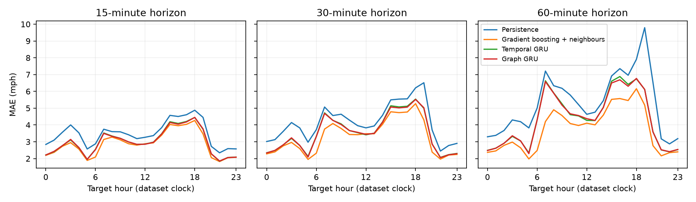
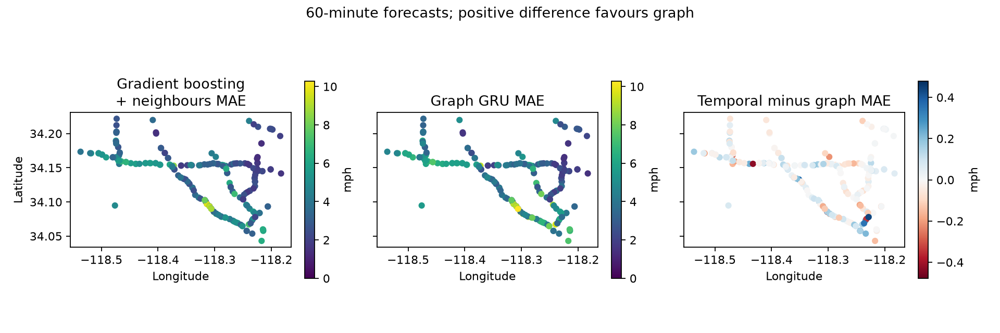
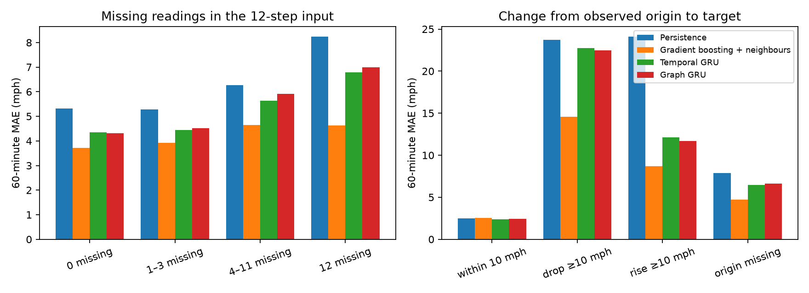
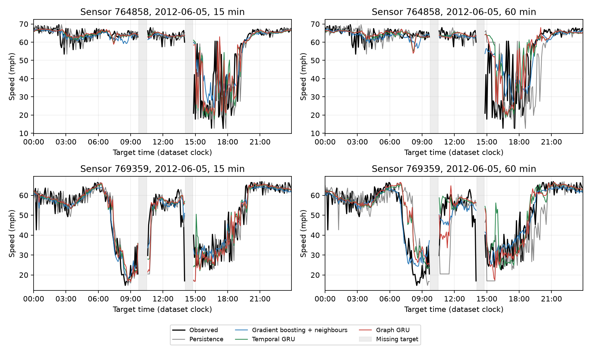
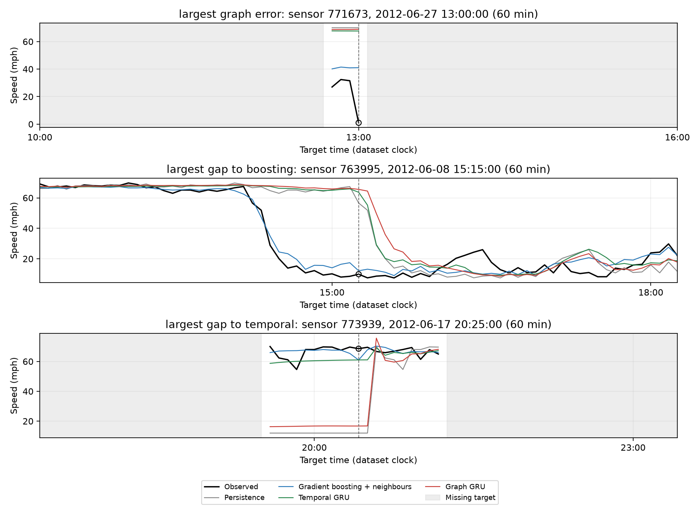

# Final forecast error analysis

We analyse the saved test predictions for all ten models without fitting or selecting models. Every prediction file is checked against the test starts, horizons, expected shape, and finite values. All 30 model/horizon aggregates reproduce `metrics.csv`. Each of 150 subgroup partitions reproduces the pooled count, MAE, RMSE, and MAPE from its observed targets. Partition checks use unrounded scores; CSV tables round to eight decimal places. Full tables are in `outputs/error_analysis/detailed/`.

The main figures compare persistence, neighbour boosting, the temporal GRU, and the graph GRU. Other classical models and the separately trained disabled graph remain in the CSV tables. The disabled graph duplicates the temporal GRU, so it is not drawn as another curve. Horizon labels are lead times from the final input to the target. Hours and dates use the dataset timestamps as supplied, with no timezone conversion. Zero targets are excluded from every score.

## Error by time of day

The graph model's 60-minute MAE is highest at target hour 18:00 (6.770 mph) and lowest at 05:00 (2.294 mph). These hours describe this test period and are not selected deployment schedules. `hour_metrics.csv` includes every model, horizon, hour, and observed count. `day_type_metrics.csv` provides weekday/weekend scores. Hours are grouped by target time, so a 60-minute forecast in the 08:00 group was issued one hour earlier.



## Error across sensors

At 60 minutes, graph filtering improves sensor MAE relative to the temporal GRU for 118 of 207 sensors and worsens it for 89. The median sensor gain is 0.0114 mph. These counts give each sensor equal weight, whereas aggregate metrics weight observed target pairs. They do not establish statistical significance or independent replications. Sensor percentiles below are unweighted across sensors and are not pooled errors.

| Model | Sensor MAE median | Sensor MAE 90th percentile | Sensor MAE maximum |
| --- | --- | --- | --- |
| Persistence | 5.282 | 8.206 | 11.121 |
| Gradient boosting + neighbours | 3.386 | 6.027 | 9.713 |
| Temporal GRU | 4.105 | 7.012 | 10.145 |
| Graph GRU | 4.049 | 7.032 | 10.271 |

The maps align sensors by ID with their dataset coordinates. The first two maps share a colour scale. The difference map has a symmetric scale; positive values favour the graph model. Per-sensor observed counts are available in `sensor_metrics.csv`, so errors on sensors with little data can be identified.



## Missing inputs and rapid speed changes

Input availability counts missing readings in the sensor's own twelve-step history. All four groups partition observed targets: no missing inputs, 1–3 missing inputs, 4–11 missing inputs, or all twelve missing. These groups describe input availability; they do not identify outage causes. Correlations between missingness and error are not causal effects.

60-minute MAE by input availability:

| input_missing | Persistence | Gradient boosting + neighbours | Temporal GRU | Graph GRU |
| --- | --- | --- | --- | --- |
| 0 missing | 5.309 | 3.725 | 4.348 | 4.317 |
| 1–3 missing | 5.277 | 3.916 | 4.442 | 4.523 |
| 4–11 missing | 6.263 | 4.649 | 5.641 | 5.907 |
| 12 missing | 8.235 | 4.637 | 6.786 | 6.996 |

Fully observed inputs account for 92.63% of observed 60-minute targets. In that group, graph filtering reduces temporal-GRU MAE by 0.031 mph. For histories with 1–3, 4–11, and all twelve readings missing, graph MAE increases by 0.081, 0.266, 0.210 mph respectively. The small aggregate gain therefore coexists with worse performance in each missing-input group. These groups have different traffic and sensor compositions, so this does not isolate a causal effect of missing data.

Speed-change groups compare the observed raw origin speed with the observed target. Drops of at least 10 mph and rises of at least 10 mph are separated from changes strictly within 10 mph. A missing raw origin forms its own group, even though models can use filled inputs. The drop/rise definitions mechanically imply at least 10 mph persistence error when the origin is observed. The groups use future observed targets and therefore describe forecast errors retrospectively; they are not available categories at forecast time and do not assess a detector.

| speed_change | Persistence | Gradient boosting + neighbours | Temporal GRU | Graph GRU |
| --- | --- | --- | --- | --- |
| within 10 mph | 2.495 | 2.554 | 2.395 | 2.421 |
| drop ≥10 mph | 23.741 | 14.572 | 22.738 | 22.477 |
| rise ≥10 mph | 24.089 | 8.681 | 12.106 | 11.701 |
| origin missing | 7.894 | 4.723 | 6.471 | 6.64 |

Observed 60-minute target counts, common to all models:

| speed_change | n |
| --- | --- |
| within 10 mph | 1052142 |
| drop ≥10 mph | 79220 |
| rise ≥10 mph | 79635 |
| origin missing | 35225 |



## Representative traces

We fix two sensors using their training-only low-speed shares: ranks 50% and 90% in the sorted sensor list. For each sensor, the date is the first complete test weekday with at least 80% observed targets at 60 minutes. This coverage rule does not use model errors. The chosen sensors are 764858 and 769359. They illustrate two training-defined traffic profiles and are not a random or exhaustive sample of sensors.

The plots show 15- and 60-minute forecasts at their target timestamps. Every plotted value was forecast at the recorded earlier origin. Missing ground truth produces shaded gaps in both observations and displayed predictions; the CSV retains all prediction values. `trace_values.csv` contains the exact origins, targets, input missing counts, observations, and four model predictions.



## Failure cases selected after observing test errors

We deliberately select three 60-minute cases: the largest graph-model absolute error; the largest remaining excess absolute error over neighbour boosting; and the largest remaining excess error over the temporal GRU. After each choice, target times within two hours are excluded across all sensors for later choices. This limits repeated displays of one event but does not make cases independent. Selections use observed test errors for illustration only. They do not support estimates of how often these failures occur and do not change any model or setting.

| Case | Sensor | Target | Observed mph | Missing inputs | Persistence | Gradient boosting + neighbours | Temporal GRU | Graph GRU |
| --- | --- | --- | --- | --- | --- | --- | --- | --- |
| largest_graph_error | 771673 | 2012-06-27 13:00:00 | 1.0 | 12 | 70.0 | 41.07 | 67.69 | 68.93 |
| largest_gap_to_boosting | 763995 | 2012-06-08 15:15:00 | 9.89 | 0 | 56.62 | 12.15 | 63.7 | 65.58 |
| largest_gap_to_temporal | 773939 | 2012-06-17 20:25:00 | 68.56 | 12 | 12.0 | 60.96 | 61.02 | 16.73 |

2 of the 3 selected failure cases have all twelve input readings missing. Their missing raw origins are not treated as zero speeds by the models: the pipeline carries earlier observations forward. This is a reason to report input availability alongside aggregate errors. It does not identify whether the observed target reflects an incident, recovery, or measurement problem.

Each panel spans up to three hours either side of the selected target, limited by test coverage. The vertical line and circle mark the selected target. The temporal GRU is shown explicitly because the final case selects a failure relative to it. Grey shading marks missing target readings. A sharp change or missing history is an observed association, not evidence of an incident or operational cause.



## Interpretation and limits

Aggregate scores, traffic-condition errors, hourly profiles, and sensor distributions answer different questions. The graph-versus-temporal difference is small in the main experiment, while neighbour boosting remains the strongest measured system overall. The low-speed and rapid-change subsets help explain why an overall improvement need not translate into better forecasts during congestion. Use the measured subgroup tables and traces when describing where a model helps and where it fails.

Target periods share eleven timestamps at each benchmark split boundary. Sliding windows, linked sensors, repeated targets across horizons, and shared events produce dependent errors. Group counts are forecast-target pairs, not independent samples; no confidence interval or significance claim is made. Findings apply to this METR-LA test period, one neural seed, and the recorded training budgets. Sensors, hours, and worst-case examples are not used to retune models. Repeated seeds, independent periods, and a purged-split sensitivity study would be needed for stronger generalization claims.

## Reproduction

```sh
uv run scripts/error_analysis.py
uv run scripts/detailed_error_analysis.py
```

Generate each model's saved predictions first using the evaluation and checkpoint commands in the README. `cases.json` records trace-selection rules and all selected errors; `verification.json` records aggregate and partition checks. Empty groups retain a zero count and missing metrics rather than fabricated zero error.
