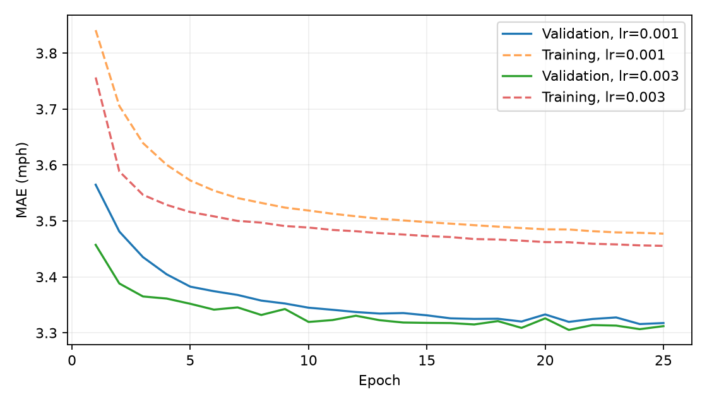
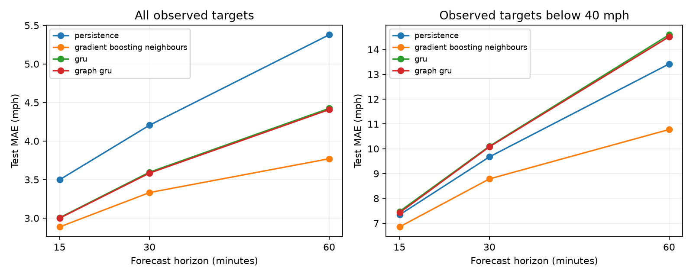

# Graph and temporal model comparison

This experiment tests whether spatial measurements help the temporal GRU. Both variants use the same 32-unit GRU and three-output persistence-residual head. A learned one-hop graph filter adds incoming and outgoing neighbour information to the speed and observation-flag channels before the recurrent layer. Calendar channels and the local persistence anchor stay unchanged. Recurrent hidden states remain local to each sensor.

## Graph construction and computation

Let `A[i,j]` be the existing road-distance weight from sensor i to j. We remove diagonal entries for neighbour aggregation because the model has a separate local path. The outgoing support `P_out` row-normalizes A; the incoming support `P_in` row-normalizes its transpose. Empty rows use the identity, giving no neighbour-minus-local signal. The two directions are kept separate. No symmetrization is applied.

At each observed input timestamp, `X` contains normalized filled speed and the observation flag. The filter is:

```text
D_in  = P_in X - X
D_out = P_out X - X
Z     = X + D_in W_in + D_out W_out
```

The implementation uses PyTorch linear-layer transpose conventions for each 2-by-2 matrix. `W_in` and `W_out` start at zero. The GRU receives Z and the original five calendar channels. The output residual is added to the original local speed, preserving the persistence anchor. Propagation uses only simultaneous input readings and the fixed road graph; it uses no future speeds or fitted test statistics. Filled neighbour speeds carry observation flags, but stale readings are not excluded or reweighted by gap length.

Bidirectional graph aggregation is motivated by the [DCRNN traffic-forecasting paper](https://arxiv.org/abs/1707.01926). Our experiment uses a one-hop linear input filter with a local recurrent state and direct horizon outputs. It does not implement diffusion in recurrent hidden states or an encoder-decoder training procedure. Graph direction represents listed source-to-destination road paths; physical upstream/downstream traffic direction has not been independently verified.

## Matched training and disabled-graph control

Both graph variants have 4,043 parameters, including eight graph-filter coefficients. The disabled variant sets both supports to the identity. Its two difference signals are exactly zero, so the graph weights have zero gradient and the remaining network reduces to the temporal GRU. We train it separately, rather than disabling messages only after fitting a graph model. Unit tests check predictions, gradients, and optimizer updates against the temporal model. Its trial scores and epoch histories match the previous temporal run within 1e-6 mph, excluding wall times; aggregate CSV metrics differ by at most 0.000000. These checks are recorded in `control_verification.json`.

All variants share seed 42, a fixed sample of 1,000,000 training window/sensor rows, batch size 2048, the same initial GRU/head parameters, Adam, masked MAE, gradient clipping at 1, and training-only speed normalization. Each variant separately selects among learning rates 0.001 and 0.003 using mean validation MAE over all three horizons. Training has a 25-epoch cap and patience of four epochs. The graph matrices do not affect sample selection or shuffling. The graph and disabled variants have the same selection budget; their chosen epochs and rates can differ.

Graph-model validation trials:

| learning_rate | best_epoch | val_mae |
| --- | --- | --- |
| 0.001 | 24 | 3.3157 |
| 0.003 | 21 | 3.3052 |

The graph model selects learning rate 0.003 at epoch 21, with validation MAE 3.3052 mph. The disabled control selects 0.003 at epoch 19. Test scores are used after selection for comparison, not for choosing settings.



## Test results

| model | MAE 15 min | MAE 30 min | MAE 60 min | RMSE 15 min | RMSE 30 min | RMSE 60 min |
| --- | --- | --- | --- | --- | --- | --- |
| persistence | 3.498 | 4.205 | 5.378 | 6.416 | 8.049 | 10.34 |
| gradient_boosting_neighbours | 2.887 | 3.332 | 3.771 | 5.164 | 6.111 | 6.986 |
| gru | 3.006 | 3.596 | 4.424 | 5.891 | 7.201 | 8.858 |
| graph_gru_no_graph | 3.006 | 3.596 | 4.424 | 5.891 | 7.201 | 8.858 |
| graph_gru | 3.0 | 3.584 | 4.408 | 5.848 | 7.141 | 8.815 |

MAE differences (graph gru no graph minus graph GRU) are 0.005, 0.012, 0.015 mph at 15, 30, and 60 minutes. Positive values favour the graph model. MAE differences (gradient boosting neighbours minus graph GRU) are -0.114, -0.253, -0.638 mph at 15, 30, and 60 minutes. Positive values favour the graph model. On low-speed targets, the corresponding disabled-control minus graph differences are 0.051, 0.022, 0.079 mph.



Low-speed targets are observed speeds below the training-selected 40 mph threshold:

| Model | 15 min MAE | 30 min MAE | 60 min MAE |
| --- | --- | --- | --- |
| persistence | 7.336 | 9.673 | 13.421 |
| gradient_boosting_neighbours | 6.849 | 8.784 | 10.776 |
| gru | 7.472 | 10.101 | 14.597 |
| graph_gru_no_graph | 7.472 | 10.101 | 14.597 |
| graph_gru | 7.421 | 10.08 | 14.518 |

The separately trained disabled graph duplicates the temporal reference within numerical tolerance, so the plot shows the temporal curve once. The table retains both records to make the ablation explicit. All models share the benchmark windows and missing-target masks. Classical neighbour boosting receives additional sensor/profile features, so its comparison with neural models is between implemented systems. The graph-versus-disabled comparison controls the neural architecture and training budget.

## Limits and remaining evaluation

Results use one seed, a fixed training sample, two learning rates, and a short training budget. They do not establish the best graph architecture or statistical significance. Adjacent benchmark split target periods overlap by eleven timestamps (55 minutes). Errors from overlapping windows, sensors, and reciprocal links are dependent. The graph filter is restricted to one-hop input aggregation and can compress neighbour information before recurrence. The identity control tests the added graph messages; a shuffled-edge control would be needed to isolate the value of this particular road topology. Repeated seeds, deeper propagation, graph effects on hidden states, and a purged-split sensitivity study remain possible extensions.

Final analysis still needs errors by sensor and time of day, representative forecast traces, and failure cases. The final report and presentation should separate measured spatial gains from limitations and avoid claiming that graph structure guarantees an improvement.

## Reproduction

```sh
uv run --extra neural scripts/train_gru.py --model graph_gru --device cpu
uv run --extra neural scripts/train_gru.py --model graph_gru_no_graph --device cpu
uv run --extra neural scripts/train_gru.py --model graph_gru --device cpu --evaluate-only
uv run --extra neural scripts/train_gru.py --model graph_gru_no_graph --device cpu --evaluate-only
uv run scripts/error_analysis.py
uv run scripts/summarize_graph.py
```

Each variant saves its checkpoint, validation histories, selected settings, learning curves, and run metadata under `outputs/neural/<model>/`. Checkpoint restoration checks the speed-data hash, road-adjacency hash, sensor order, horizons, and normalizer. Predictions retain the existing `(window, horizon, sensor)` format in `outputs/predictions/`.
