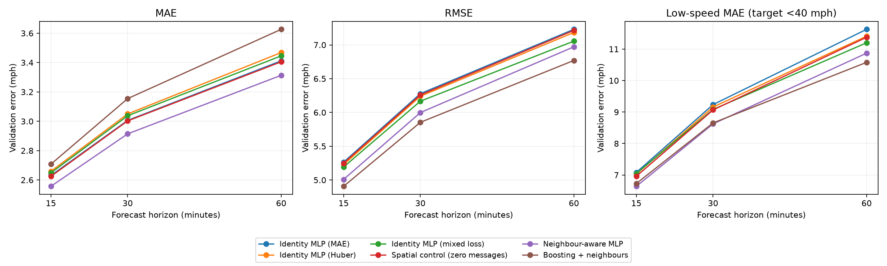
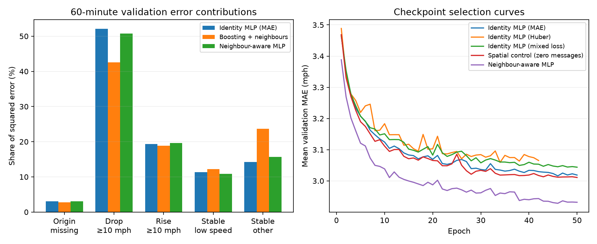

# Neural loss and neighbour experiments

This follow-up diagnoses validation residuals and tests four fixed candidates. The selected neural model by mean validation MAE is **Neighbour-aware MLP**, with 2.9281 mph. No new test predictions were generated or scored. Baseline tables and earlier checkpoints remain unchanged.

## What the validation errors show

At 60 minutes, observed drops of at least 10 mph represent 5.38% of observed forecast-target pairs but 52.09% of the identity MLP's squared error. Its signed bias in that group is +17.51 mph (prediction minus observation). It forecasts speeds that are too high during these drops. The largest 5% of absolute errors account for 79.96% of squared error.

Compared with boosting on exactly the same target pairs, the drop group contributes 119.86% of the identity MLP's net excess squared error. A contribution above 100% is possible because the MLP has less squared error than boosting in the stable-other group, offsetting part of its disadvantage elsewhere. `squared_error_difference_60.csv` records these paired contributions.

Fully observed local histories account for 94.50% of target pairs and 93.16% of squared error. Missing-history errors matter per target, but missingness alone does not explain most aggregate squared error. Neighbour availability is separate from this local-history grouping.

Predictions outside the observed training-speed range account for only 0.098% of observed 60-minute targets and 0.124% of squared error. Output overshoot outside this range is not the main source of the aggregate RMSE gap; `prediction_ranges.csv` records all horizons and models. The training range is an empirical reference, not a physical speed limit.

These groups describe observed origin-to-target changes, not detected incident onset or a causal explanation. Stable low-speed means an observed origin, a target below 40 mph, and a change strictly within 10 mph. Drops and rises take precedence; a missing raw origin forms a separate group. Future target values define these diagnostic groups and are never model inputs.

60-minute validation MAE by transition:

| group | Boosting + neighbours | Identity MLP (MAE) | Neighbour-aware MLP |
| --- | --- | --- | --- |
| origin_missing | 4.084 | 4.25 | 4.105 |
| drop_ge10 | 15.075 | 17.947 | 16.843 |
| rise_ge10 | 9.29 | 9.198 | 8.914 |
| stable_low | 6.261 | 5.932 | 5.579 |
| stable_other | 2.266 | 1.837 | 1.838 |

## Fixed experiment protocol

All trials retain twelve input steps, sensor and target-calendar embeddings, local gap age, observed-target masking, the training normalizer, and the benchmark chronological windows. They use seed 42, CPU with four PyTorch threads, AdamW (learning rate 0.001, weight decay 0.0001), batches of 2048, gradient clipping at 1, fresh one-million-row samples each epoch, and a cap of 50 epochs. ReduceLROnPlateau uses factor 0.5, patience three, and threshold 0.0001; early stopping uses patience eight.

Checkpoint selection is minimum mean validation MAE over 15, 30 and 60 minutes for every objective. RMSE and low-speed MAE are secondary measurements, not alternate checkpoint selection rules. The formulas below were fixed before the runs. All losses divide by the training speed standard deviation `std` and exclude zero targets.

- MAE reference: `mean(abs(error)) / std`, using the recorded identity MLP checkpoint.
- Huber candidate: PyTorch smooth L1 with beta 5 mph, divided by `std` (Huber divided by its delta). It changes both the preferred predictor and gradients near zero error; it does not selectively upweight large errors relative to MAE.
- Mixed candidate: `(0.8 * mean(abs(error)) + 0.2 * mean(error**2) / std) / std`. This increases the relative contribution of large errors.
- Spatial candidate and its control: the original MAE objective, with the architecture described below.

| variant | best_epoch | val_mae | parameters | matched_baseline_sample_epochs |
| --- | --- | --- | --- | --- |
| huber | 34 | 3.0592 | 44665 | 42 |
| mixed | 50 | 3.0438 | 44665 | 50 |
| spatial_control | 50 | 3.0109 | 76569 | 50 |
| spatial | 46 | 2.9281 | 76569 | 50 |

Histories record training-sample hashes. Every candidate matches the original seed-42 sampling plan for all common epochs; all four share 42 epochs. The spatial pair starts with exactly identical parameter values and has 76,569 parameters each. The identity loss variants retain 44,665 parameters. Differences between the larger control and the original baseline bundle capacity and initialization changes; only the spatial-versus-control contrast isolates access to neighbour messages within the new architecture.

## Neighbour model and matched control

Each road direction aggregates four channels at every input timestamp: normalized filled speed, observed-weight share, log gap age, and reliability mass. Road weights have no self-loops and are row-normalized separately for incoming and outgoing directions. Reliability is `1 / (1 + consecutive missing steps)`; speed and log age are averaged with road weights multiplied by reliability. Observed share uses the original normalized road weights. Reliability mass is supplied explicitly. An empty road row produces zeros. All messages use current or earlier input timestamps, never future target speeds.

The twelve-step incoming/outgoing histories feed a bias-free 96-to-32 linear projection and ReLU. These 32 hidden channels concatenate with the original 64 local history channels and 32 identity/calendar/horizon channels. Two 128-wide residual blocks predict a correction around local persistence. The zero-initialized head reproduces persistence before training.

The control multiplies all neighbour channels by zero before the bias-free spatial encoder. It keeps the same parameters, initialization, optimizer and sample plan. This is a pooled-neighbour history MLP, not Graph WaveNet, DCRNN, or learned graph message passing. Reliability weighting and road direction are bundled; their separate contributions are not isolated.

## Validation results

The table reports the arithmetic mean of the three horizon metrics. Mean RMSE is not a pooled RMSE. Low-speed groups use observed targets below 40 mph. Bias is prediction minus observation. The frontier marks models not dominated on both mean MAE and mean RMSE among these six recorded candidates; it does not measure uncertainty or include low-speed MAE in dominance.

| Model | Mean MAE | Mean RMSE | Mean low-speed MAE | 60-min bias | MAE/RMSE frontier |
| --- | --- | --- | --- | --- | --- |
| Identity MLP (MAE) | 3.016 | 6.2578 | 9.3157 | 0.8819 | no |
| Identity MLP (Huber) | 3.0592 | 6.2175 | 9.1994 | 0.62 | no |
| Identity MLP (mixed loss) | 3.0438 | 6.1385 | 9.1101 | 0.6242 | no |
| Spatial control (zero messages) | 3.0109 | 6.2413 | 9.1344 | 0.7163 | no |
| Neighbour-aware MLP | 2.9281 | 5.993 | 8.7115 | 0.7217 | yes |
| Boosting + neighbours | 3.1628 | 5.8436 | 8.6538 | -0.1001 | yes |

| Model | MAE 15 min | MAE 30 min | MAE 60 min | RMSE 15 min | RMSE 30 min | RMSE 60 min |
| --- | --- | --- | --- | --- | --- | --- |
| Identity MLP (MAE) | 2.6302 | 3.006 | 3.4118 | 5.265 | 6.2782 | 7.2303 |
| Identity MLP (Huber) | 2.6593 | 3.0501 | 3.4682 | 5.2284 | 6.2404 | 7.1836 |
| Identity MLP (mixed loss) | 2.6483 | 3.0376 | 3.4455 | 5.1923 | 6.1671 | 7.0561 |
| Spatial control (zero messages) | 2.6249 | 3.0026 | 3.4051 | 5.2498 | 6.2595 | 7.2145 |
| Neighbour-aware MLP | 2.5568 | 2.9143 | 3.3132 | 5.0092 | 5.9984 | 6.9714 |
| Boosting + neighbours | 2.7075 | 3.1545 | 3.6264 | 4.9066 | 5.8539 | 6.7702 |



The neighbour-aware model reduces mean validation MAE by 2.75% relative to its matched control. In the 60-minute drop group, its MAE is 16.843 mph versus 17.692 for the control. Model rankings apply to this validation period and budget. Read MAE, RMSE and low-speed MAE together; the report does not promote a model solely because one secondary metric improves.



## What this batch supports

The Huber candidate changes mean MAE by +0.0432 mph and mean RMSE by -0.0403 mph relative to the original identity MLP. Mixed loss changes them by +0.0278 and -0.1193 mph. These are fixed-objective comparisons using MAE-selected checkpoints; a different primary selection metric would define a different experiment.

The spatial pair measures the contribution of pooled road-neighbour histories within this architecture. It does not identify whether road direction, reliability weights, neighbour speeds or gap features caused that contribution. Repeating the matched pair with further seeds is the next check before treating any spatial gain as stable. A fuller temporal convolution or adaptive-graph model would then test a separate architectural hypothesis. No new test-period selection is needed to describe this validation evidence.

## Verification and limits

All saved validation arrays are checked for start indices, horizons, shape and finite predictions. Every checkpoint is restored and its selected score reproduced. `extend_neural.py --evaluate-only` also requires exact equality with an existing saved prediction array. Each transition, speed, missing-count and gap-age partition reproduces pooled count, MAE, RMSE, MAPE and squared-error totals. The boosting reference is refitted with its existing chosen settings solely to recover validation predictions; all nine validation MAE/RMSE/MAPE values must match the recorded four-decimal metrics within 0.000051 before saving.

This is a single-seed architecture/loss comparison. Validation has been reused for model development; the measured winner is not an unbiased estimate of future performance. Adjacent benchmark split targets overlap eleven timestamps, as in earlier experiments. Counts are dependent forecast-target pairs, not independent observations. A new independent period or rolling-origin evaluation and repeated matched seeds are required before broader claims. A best epoch at the cap does not establish convergence. No conclusion about traffic propagation or incident causes follows from subgroup errors.

## Reproduction

Generate the original identity validation predictions first if they are absent, using the earlier investigation's checkpoint restoration. Then:

```sh
uv run --extra neural scripts/extend_neural.py
uv run --extra neural scripts/extend_neural.py --evaluate-only
OMP_NUM_THREADS=2 OPENBLAS_NUM_THREADS=2 uv run --extra neural scripts/diagnose_neural.py --restore-boosting
uv run --extra neural scripts/diagnose_neural.py
uv run --extra neural scripts/summarize_neural_followup.py
```

Artifacts live in `outputs/experiments/neural_followup/`; large prediction arrays remain under ignored `outputs/predictions/`. The contract records data and graph hashes, sensor order, normalizer, objective formulas, selection rule, settings and software versions. No official results file is written by these scripts.
