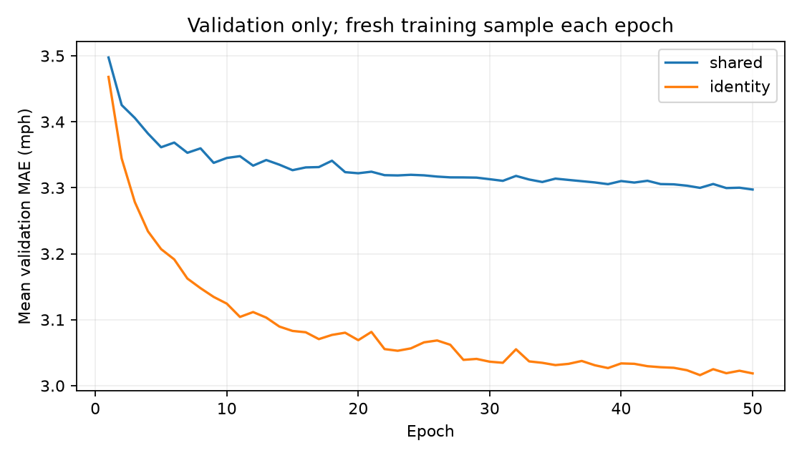
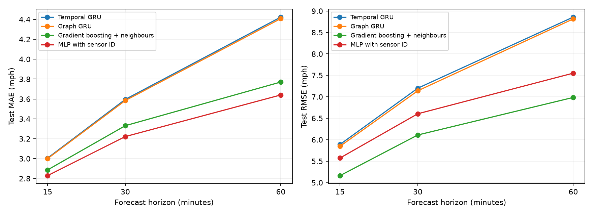

# Strengthening the neural baseline

A residual MLP with sensor and target-time embeddings improves on our original neural models in this investigation. It also has lower aggregate test MAE than gradient boosting + neighbours at all three horizons. Boosting retains lower RMSE and lower MAE on low-speed targets. This is a measured tradeoff, not a universal model ranking.

The published results remain unchanged. New experiments are stored under `outputs/experiments/identity_mlp/`. This investigation starts from the existing benchmark split, with the same twelve input steps, three horizons, training normalizer, and observed-target mask.

## Diagnosis of the original neural comparison

- The temporal GRU has 4,035 parameters shared across all 207 sensors, with no sensor identity or weekly-profile feature. Two sensors with identical input readings and calendar features receive identical forecasts. The classical boosting model receives sensor identity and a training weekly profile, so its feature set is richer.
- The graph variant adds only eight coefficients. It compresses incoming/outgoing speed and flag signals back into two channels before recurrence. This tests a small input filter, not a full graph neural forecasting architecture.
- The old GRUs reuse a fixed one-million-row sample, about one fifth of all training window/sensor rows, for at most 25 epochs. Some trials improve at the cap. This leaves training-data coverage and optimization budget as possible limits.
- An observation flag identifies a missing input but does not tell the model how long its filled value has been stale. The earlier analysis highlighted missing-history failures, motivating a causal gap-age feature. Its contribution is not isolated by the identity ablation below.

These are architectural and protocol observations. They do not establish that any one issue alone caused the old performance gap.

## Experiment and matched identity ablation

The candidate is inspired by [STID](https://arxiv.org/abs/2208.05233), which studies sensor/time identities in MLP forecasting. Our implementation is a custom horizon-conditioned residual MLP, not a reproduction of the published model or its reported scores.

The input is the twelve normalized speeds and observation flags plus `log(1 + consecutive missing steps)` at the forecast origin. Leading gaps count from the beginning of the series; gap age uses no future observations. A 64-unit history projection is concatenated with a 16-dimensional sensor embedding, target time-of-day embedding (8 dimensions), target day-of-week embedding (4), and horizon embedding (4). Target calendar values are known at forecast time. Two residual blocks operate on the resulting 96 channels, with ReLU and dropout 0.1. A shared linear head predicts each horizon's residual around the local persistence value. Its zero initialization reproduces persistence before training.

Both variants have 44,665 parameters. The control multiplies sensor embeddings by zero, while retaining calendar identities, gap age, capacity, optimizer, and training budget. Thus the comparison isolates access to sensor identity within this architecture. It does not isolate gap age, calendar embeddings, MLP architecture, or increased training budget relative to the old GRU.

Both seed-42 variants use AdamW (initial learning rate 0.001, weight decay 0.0001), gradient clipping at 1, batch size 2048, masked MAE divided by the training speed standard deviation, and up to 50 epochs. ReduceLROnPlateau halves the rate after validation plateaus; early stopping uses patience eight. Each epoch draws a fresh uniform sample of one million training window/sensor rows without replacement. The two variants have identical initialized parameter values and matched sample hashes for all 50 common epochs. Checkpoints minimize mean validation MAE across the horizons. Training budgets differ from the original GRU experiment and are disclosed rather than attributed solely to architecture.

Validation selections:

| variant | seed | best_epoch | val_mae | parameters |
| --- | --- | --- | --- | --- |
| shared | 42 | 50 | 3.2973 | 44665 |
| identity | 42 | 46 | 3.016 | 44665 |

Validation MAE by horizon:

| model | MAE 15 min | MAE 30 min | MAE 60 min |
| --- | --- | --- | --- |
| Gradient boosting + neighbours | 2.708 | 3.155 | 3.626 |
| Graph GRU | 2.740 | 3.245 | 3.930 |
| Temporal GRU | 2.752 | 3.271 | 3.966 |
| MLP with sensor ID | 2.630 | 3.006 | 3.412 |
| MLP without sensor ID | 2.723 | 3.233 | 3.936 |

Mean validation MAE falls from 3.2973 mph without sensor identity to 3.0160 with it, an 8.53% reduction under matched settings. The original GRU is 3.3295, the graph GRU 3.3052, and gradient boosting + neighbours 3.1628 mph. Reference metrics are stored to four decimals; candidate scores retain full precision in their experiment CSVs.



A second seed (43) repeats the identity model with unchanged settings and validation-only scoring. Its best mean validation MAE is 3.0153 mph, compared with seed 42's 3.0160. It was not used to replace the seed-42 test candidate and has no test evaluation. Two seeds are a robustness check, not a confidence interval or a full seed study.

## Selected candidate on the existing test period

Only the seed-42 validation winner was evaluated on test. No test result was used to change its settings or select another checkpoint. Checkpoint restoration first reproduced the selected validation score. Predictions use the existing window-major `(window, horizon, sensor)` format and are saved separately from official model predictions.

| model | MAE 15 min | MAE 30 min | MAE 60 min | RMSE 15 min | RMSE 30 min | RMSE 60 min |
| --- | --- | --- | --- | --- | --- | --- |
| Gradient boosting + neighbours | 2.887 | 3.332 | 3.771 | 5.164 | 6.111 | 6.986 |
| Graph GRU | 3.000 | 3.584 | 4.408 | 5.848 | 7.141 | 8.815 |
| Temporal GRU | 3.006 | 3.596 | 4.424 | 5.891 | 7.201 | 8.858 |
| MLP with sensor ID | 2.829 | 3.222 | 3.641 | 5.575 | 6.605 | 7.551 |

Relative to gradient boosting + neighbours, candidate MAE is lower by 1.98%, 3.29%, 3.45% at 15, 30 and 60 minutes. Its RMSE is higher at every horizon. Lower mean absolute error therefore does not imply fewer large misses.



Low-speed MAE, grouping by observed targets below 40 mph:

| model | MAE 15 min | MAE 30 min | MAE 60 min |
| --- | --- | --- | --- |
| Gradient boosting + neighbours | 6.849 | 8.784 | 10.776 |
| Graph GRU | 7.421 | 10.080 | 14.518 |
| Temporal GRU | 7.472 | 10.101 | 14.597 |
| MLP with sensor ID | 7.228 | 9.343 | 11.644 |

The candidate improves low-speed error over the previous neural models, but boosting remains better in this subset at every horizon. The training objective optimizes average masked MAE; it does not specifically optimize congestion errors or RMSE.

Candidate MAE by own-sensor input availability:

| Input availability | MAE 15 min | MAE 30 min | MAE 60 min |
| --- | --- | --- | --- |
| complete_input | 2.79 | 3.171 | 3.579 |
| missing_input | 3.486 | 3.974 | 4.412 |

These subgroups are descriptive and have different sensor and traffic compositions. Gap age was supplied to both MLP variants; an age-feature ablation would be required to measure its independent contribution.

## What to do next

1. Use the identity-aware MLP as the stronger neural reference. Keep the old GRU experiment as evidence of development. Repeat further seeds and evaluate on an independently reserved period before making broad generalization claims.
2. Test spatial modelling on top of this stronger reference. Preserve local and neighbour information as separate hidden channels, add observation/gap-aware message weights, and compare against a matched identity-only control. The original two-channel graph filter may discard information before recurrence; that is a hypothesis for a controlled ablation.
3. If a fuller graph architecture is justified, [Graph WaveNet](https://arxiv.org/abs/1906.00121) combines adaptive dependencies with dilated temporal convolutions. It addresses learned spatial relationships and temporal context beyond our small graph filter. A faithful implementation and matched evaluation would be a separate experiment.
4. Investigate the RMSE/congestion tradeoff using validation data: compare objectives such as Huber or mixed MAE/MSE and inspect a validation Pareto frontier. Define the intended metric before selection. Do not use these test results to tune the candidate retrospectively.
5. Extend training-data coverage or the epoch budget based on validation learning curves. The no-identity control's best checkpoint hits epoch 50; convergence is not established. Resampling improves coverage, but each epoch still uses a sample rather than a full pass through all rows.

## Limits

The test period had already been examined in earlier project analysis, and that analysis helped motivate the missing-gap feature. The new test comparison is exploratory evidence, not a fresh unseen holdout. The benchmark also retains eleven overlapping target timestamps at each split boundary. A new independent period or rolling-origin evaluation is needed for stronger claims about generalization.

Sensor identity is learned for the existing METR-LA nodes; unseen-sensor transfer is not tested. The MLP uses no road graph. Improvements from identity do not prove spatial propagation or road-topology benefits. The two-seed validation check, limited optimizer search, changed data budget, and feature differences must remain part of the interpretation.

## Reproduction

```sh
uv run --extra neural scripts/investigate_neural.py
uv run --extra neural scripts/investigate_neural.py --evaluate-only
uv run --extra neural scripts/evaluate_identity.py --seed 42
uv run --extra neural scripts/investigate_neural.py --seed 43 --variants identity
uv run scripts/summarize_identity.py
```

The contract records data hash, sensor order, horizons, normalizer, seed, optimizer settings and software versions. A different contract in an existing seed folder is rejected. Trial histories record each epoch's training-sample hash. Checkpoints are saved on validation improvement. All official result CSVs and original neural checkpoints are retained.
