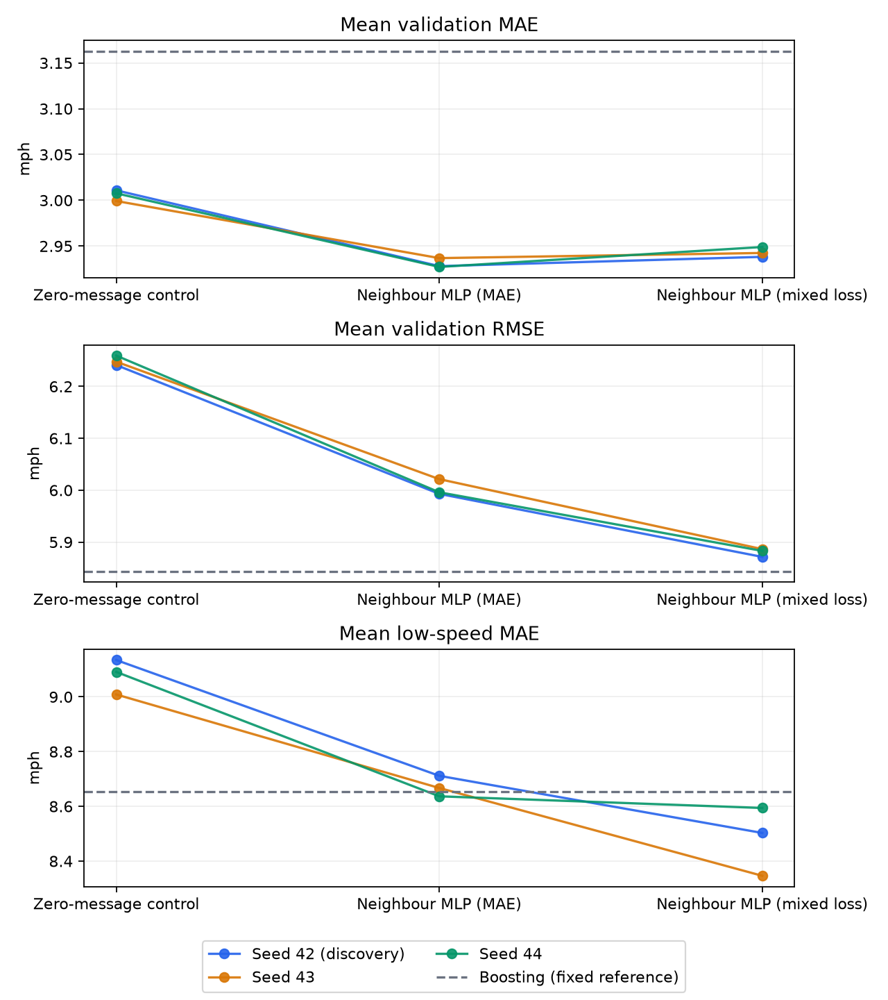

# Spatial replication and mixed-loss experiment

The spatial/control comparison was repeated with seeds 43 and 44, retaining seed 42 as discovery evidence. The predeclared replication criterion **passed**: neighbour-aware MAE must be below its matched control separately for both new seeds. The selected architecture/objective by mean validation MAE across all three seeds is **Neighbour MLP (MAE)**. No best seed is selected and no new test predictions are generated or scored.

## Protocol fixed before replication results

`outputs/experiments/spatial_replication/protocol.json` records the gate, seeds, conditional mixed-loss stage and selection rule. All runs retain the original data windows, twelve input steps, training normalizer, graph construction and reliability-weighted messages. Each variant has 76,569 parameters. Optimizer, scheduler, clipping, fresh one-million-row sampling, batch size 2048, 50-epoch cap and early-stopping patience eight match the original follow-up. Runs use CPU and four PyTorch threads; concurrent runs have separate seeds and artifact directories.

Within each seed, the control and spatial model initialize identically; the control zeros messages before its bias-free encoder. Spatial MAE and spatial mixed loss use the same model initialization. Sample hashes match for all common epochs within each seed, including the mixed-loss trial when present. Sample plans differ across seeds. The control isolates access to neighbour messages within this architecture; seed replication does not isolate road direction, reliability weighting or individual message channels.

Every checkpoint minimizes mean validation MAE over 15, 30 and 60 minutes. The mixed objective retains the earlier fixed formula `(0.8 * MAE + 0.2 * MSE / training_std) / training_std`. No coefficient, seed or checkpoint is chosen using test scores or secondary metrics. The mixed-loss stage runs only after both new spatial pairs pass the gate.

## Matched spatial results

| seed | control_mae | spatial_mae | spatial_gain_pct | improved |
| --- | --- | --- | --- | --- |
| 42 | 3.0109 | 2.9281 | 2.7494 | True |
| 43 | 2.9992 | 2.9369 | 2.0794 | True |
| 44 | 3.0076 | 2.9272 | 2.6731 | True |

Seed 42 was used to develop this hypothesis. Seeds 43 and 44 are repetitions on the same validation period, with new initialization and training-row draws. These are not three independent traffic periods or a significance test.

## All validation results

Each run's metric is the arithmetic mean of its three horizon metrics. The summary reports the mean and sample standard deviation across three runs. Standard deviations describe seed sensitivity on this fixed validation set, not confidence intervals for future traffic. Mean RMSE is not pooled RMSE.

| Model | Mean MAE | MAE seed SD | Mean RMSE | RMSE seed SD | Mean low-speed MAE | Low-speed seed SD |
| --- | --- | --- | --- | --- | --- | --- |
| Zero-message control | 3.0059 | 0.006 | 6.2495 | 0.0092 | 9.078 | 0.0639 |
| Neighbour MLP (MAE) | 2.9307 | 0.0053 | 6.0035 | 0.0156 | 8.6717 | 0.0376 |
| Neighbour MLP (mixed loss) | 2.9432 | 0.0054 | 5.8803 | 0.0078 | 8.481 | 0.1253 |

| Seed | Model | Mean MAE | Mean RMSE | Mean low-speed MAE | Drop MAE 60 min |
| --- | --- | --- | --- | --- | --- |
| 42 | Neighbour MLP (MAE) | 2.9281 | 5.993 | 8.7115 | 16.8431 |
| 42 | Zero-message control | 3.0109 | 6.2413 | 9.1344 | 17.6924 |
| 42 | Neighbour MLP (mixed loss) | 2.9382 | 5.8715 | 8.5028 | 16.1328 |
| 43 | Neighbour MLP (MAE) | 2.9369 | 6.0214 | 8.667 | 16.8809 |
| 43 | Zero-message control | 2.9992 | 6.2477 | 9.0087 | 17.3579 |
| 43 | Neighbour MLP (mixed loss) | 2.9425 | 5.8864 | 8.3463 | 15.793 |
| 44 | Neighbour MLP (MAE) | 2.9272 | 5.996 | 8.6367 | 16.698 |
| 44 | Zero-message control | 3.0076 | 6.2595 | 9.0911 | 17.7478 |
| 44 | Neighbour MLP (mixed loss) | 2.949 | 5.883 | 8.594 | 16.2156 |

The fixed neighbour-boosting reference has mean validation MAE 3.1628 mph, mean RMSE 5.8436 mph, mean low-speed MAE 8.6538 mph and 60-minute drop MAE 15.0748 mph. These values come from the earlier single fit, not three new boosting runs. Its saved predictions reproduce all nine recorded validation MAE/RMSE/MAPE scores within the original rounding tolerance.

Mixed loss changes mean MAE by +0.0125 mph, mean RMSE by -0.1232 mph, and mean low-speed MAE by -0.1907 mph relative to the spatial MAE model, averaged over the three paired seeds. Negative changes indicate lower error. Checkpoints still minimize MAE; there is no RMSE-based checkpoint reselection.



For the original seed-42 diagnosis, large speed drops dominate the identity MLP's excess squared error over boosting. This report retains the same retrospective drop definition and records 60-minute drop MAE for every seed in `per_seed.csv`; all transition and missing-input groups appear in `partitions.csv`. The group uses observed future targets and cannot serve as a forecast-time input or an incident detector.

## Verification and limits

Saved predictions must match validation starts, horizons, shape and finite-value checks. Every checkpoint is restored and every saved validation prediction must match exactly. Their scores reproduce selected checkpoint MAE within 0.000001 mph. Checkpoint hashes match selection records. Every subgroup partition reproduces count, MAE, RMSE, MAPE and squared-error totals; 108 partitions are verified. All 90 protected earlier result/checkpoint artifacts retain their recorded hashes. Evaluate-only restoration checks exact prediction equality before rewriting an existing prediction file.

Three seeds provide a limited check of initialization and sampled-training sensitivity. Validation is reused for model development, and the benchmark split retains eleven overlapping target timestamps at its boundaries. No claim of an unseen holdout, independent forecast-target pairs, or causal traffic propagation follows from these results. Repeated periods with purged boundaries or new data remain necessary for stronger generalization claims. 5 of the 9 selected checkpoints occur at epoch 50; convergence is not established for those runs.

## Reproduction

```sh
uv run --extra neural scripts/extend_neural.py --seed 43 --variants spatial_control spatial
uv run --extra neural scripts/extend_neural.py --seed 44 --variants spatial_control spatial
uv run --extra neural scripts/summarize_spatial_replication.py --gate-only
# Only if the gate passes, run each of seeds 42, 43 and 44 with:
uv run --extra neural scripts/extend_neural.py --seed 42 --variants spatial_mixed --output-dir outputs/experiments/spatial_replication
# Verify each trial by repeating its command with --evaluate-only.
uv run --extra neural scripts/summarize_spatial_replication.py
```

Spatial/control checkpoints remain under `outputs/experiments/neural_followup/seed_<seed>/`. New spatial mixed-loss checkpoints and this report's tables, protocol, preservation manifest and verification live under `outputs/experiments/spatial_replication/`. Prediction arrays remain under ignored `outputs/predictions/`. A temporal convolution or adaptive-graph architecture would be a separate next experiment.
