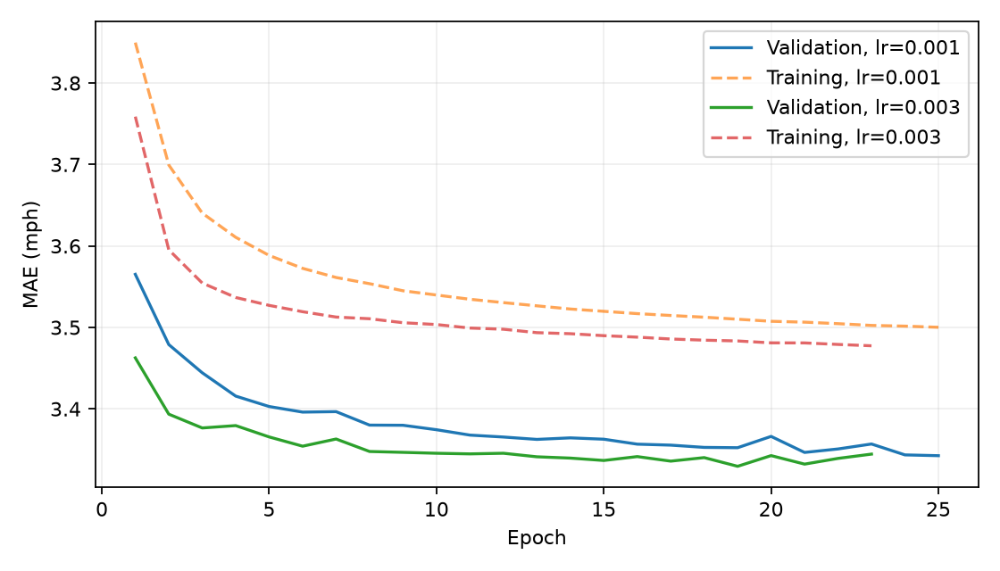
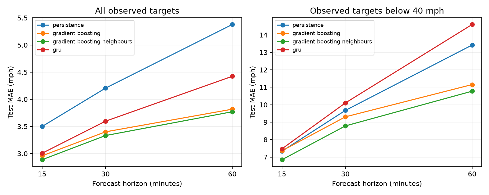

# Temporal neural baseline

The temporal baseline uses a single-layer GRU with 32 hidden units, shared across all 207 sensors. Each forecast uses only the sensor's own twelve five-minute input readings. The seven input channels are training-normalized filled speed, an observation flag, sine/cosine encodings of time of day and week, and a weekend flag. Calendar channels describe the input timestamps. No sensor ID, weekly-profile feature, or neighbouring sensor measurement is supplied.

The final hidden state feeds a linear head with three direct outputs for 15, 30, and 60 minutes. Outputs are residuals around the last input speed. The head starts at zero, so the untrained model reproduces persistence. There is no recursive use of future predicted or observed speeds. Model size is 4,035 trainable parameters.

## Training and selection

We train with Adam and masked MAE, excluding zero targets. The loss is divided by the training speed standard deviation for optimization, with gradient norm clipped at 1. The speed normalizer uses the same observed training-period values as the existing data pipeline. Training uses a fixed seeded sample of 1,000,000 window/sensor rows, shared across both learning-rate trials and shuffled each epoch. This reduces computation; it does not cover every training row. Missing horizons remain masked within sampled rows.

The seed is 42. Batch size is 2048; training stops after 4 epochs without improvement, subject to a 25-epoch cap per trial. Every epoch is evaluated on all observed validation targets. We select the learning rate and checkpoint by mean validation MAE across the three horizons. Test data is scored after selection. Both trials use the same initialized weights and training sample.

| learning_rate | best_epoch | val_mae |
| --- | --- | --- |
| 0.001 | 25 | 3.3425 |
| 0.003 | 19 | 3.3295 |

The selected learning rate is 0.003, at epoch 19. Its mean validation MAE is 3.3295 mph. Training used cpu and PyTorch 2.15.0; full settings and data hash are saved in `outputs/neural/run_metadata.json`. The selected CPU state dictionary, configuration, normalization, horizons, and sensor order are saved in `outputs/neural/gru.pt`.



## Test comparison

| model | MAE 15 min | MAE 30 min | MAE 60 min | RMSE 15 min | RMSE 30 min | RMSE 60 min |
| --- | --- | --- | --- | --- | --- | --- |
| gradient_boosting | 2.958 | 3.4 | 3.818 | 5.402 | 6.323 | 7.125 |
| gradient_boosting_neighbours | 2.887 | 3.332 | 3.771 | 5.164 | 6.111 | 6.986 |
| gru | 3.006 | 3.596 | 4.424 | 5.891 | 7.201 | 8.858 |
| persistence | 3.498 | 4.205 | 5.378 | 6.416 | 8.049 | 10.34 |

GRU MAE is 0.493, 0.609, 0.955 mph lower than persistence at 15, 30, and 60 minutes respectively. GRU MAE is 0.119, 0.265, 0.653 mph higher than gradient boosting neighbours at 15, 30, and 60 minutes respectively. The aggregate improvement over persistence does not extend to low-speed targets: GRU has higher MAE in that subset at every horizon. Report both conditions when assessing its usefulness.



Low-speed MAE uses the training-selected 40 mph threshold and excludes missing targets:

| Model | 15 min MAE | 30 min MAE | 60 min MAE |
| --- | --- | --- | --- |
| gradient_boosting | 7.359 | 9.305 | 11.155 |
| gradient_boosting_neighbours | 6.849 | 8.784 | 10.776 |
| gru | 7.472 | 10.101 | 14.597 |
| persistence | 7.336 | 9.673 | 13.421 |

The saved GRU predictions use the existing `(window, horizon, sensor)` format, window starts, and horizon steps. The condition-analysis script checks their alignment and reproduces aggregate metrics before reporting these subsets.

## Interpretation and next experiment

These results measure one temporal architecture under one seed and a limited learning-rate search. They do not establish the best possible neural baseline. Classical boosting receives sensor identity and profile features that this GRU does not receive, so the comparison measures the implemented systems rather than isolating architecture alone. Small differences are descriptive, with no significance claim.

The benchmark target periods retain eleven overlapping timestamps at each split boundary. The training normalizer includes the full benchmark training period. The fixed sample and device-dependent floating-point arithmetic also limit reproducibility across hardware; repeated seeds have not been run.

The next experiment should add explicit graph aggregation while keeping the temporal architecture, input channels, training sample, seed, optimizer, selection budget, and evaluation protocol comparable. Include a disabled-graph ablation to isolate the spatial contribution. Neural-model error by sensor, time of day, and representative trajectories also remains to be completed.

## Reproduction

```sh
uv sync --extra neural
uv run --extra neural scripts/train_gru.py --device cpu
uv run --extra neural scripts/train_gru.py --device cpu --evaluate-only
uv run scripts/error_analysis.py
uv run scripts/summarize_neural.py
```

The evaluate-only command restores the committed checkpoint and rejects a different data hash or sensor/horizon order. Learning curves and validation trial histories are saved alongside the checkpoint. Test predictions in `outputs/predictions/` remain local and can be regenerated from it.
